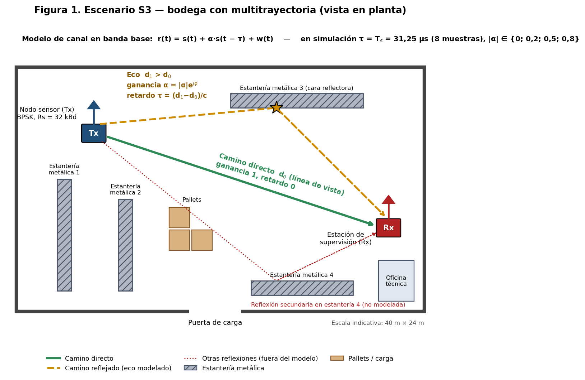
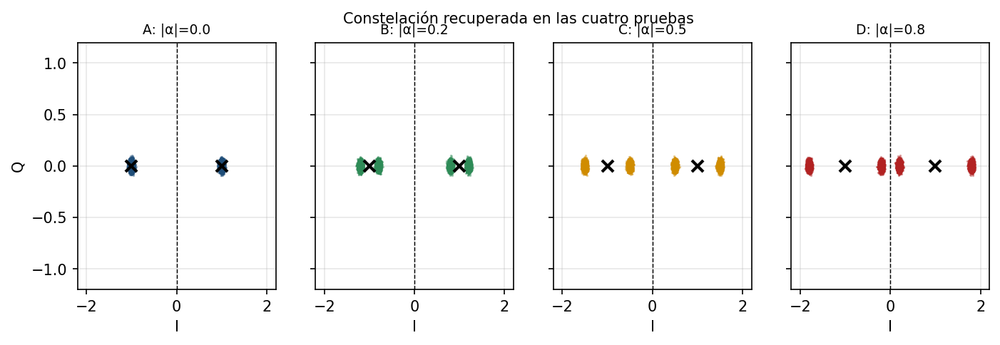

# Enlace BPSK interior con multitrayectoria — Comunicaciones II (27145), Grupo 5

> **Blog:** por indicación del grupo, en esta entrega no se elaboró blog.
> **Video de socialización (8 min 57 s):** **[YouTube: https://youtu.be/vqxYRCAwkvc](https://youtu.be/vqxYRCAwkvc)** · copia en el repositorio: [`video/Video_Socializacion_Grupo5_S3.mp4`](video/Video_Socializacion_Grupo5_S3.mp4) · subtítulos [`video/Video_Socializacion_Grupo5_S3.srt`](video/Video_Socializacion_Grupo5_S3.srt)
> **Informe IEEE:** [`docs/informe_final.pdf`](docs/informe_final.pdf)

**Escenario:** S3 · Comunicación interior con multitrayectoria (bodega con estanterías metálicas)
**Integrantes:** Elkin Largo (2182334) · Stiven Muñoz (2224110) · Minuk Lee — Universidad Industrial de Santander
**Última actualización:** 12 de noviembre de 2026

## Resumen
Se diseñó y simuló en GNU Radio un enlace BPSK para un sensor en una bodega, donde una reflexión metálica produce un eco retardado. El canal se modela como camino directo más un eco de ganancia α y retardo τ = Ts, con AWGN. Se implementó un receptor con filtro acoplado rectangular, diagrama de ojo, muestreo de una muestra por símbolo y decisión por umbral. En las cuatro pruebas (|α| = 0; 0,2; 0,5; 0,8):
- la constelación se desdobla en ±1±α;
- el ojo se cierra según 2(1−|α|);
- la PSD muestra el peine |1+αe^{−j2πfTs}|².

Con el instrumento BER de la Fase 4 (al que se le corrigieron dos errores), la curva coincide con la teoría con una diferencia de 0,05 dB. La penalización a BER = 10⁻³ es de 1,4 dB con |α| = 0,2 y de 6,3 dB con |α| = 0,5; con |α| = 0,8 no se llega a 10⁻³ por debajo de 14 dB.

## Parámetros
| Modulación | Rs | Rb | SPS | fs | BW | Perturbación |
|---|---|---|---|---|---|---|
| BPSK (M = 2, k = 1), tabla (−1, +1), pulso rectangular | 32 kBd | 32 kb/s | 8 | 256 kS/s | 64 kHz (nulo a nulo, 2Rs) | Eco: retardo 8 muestras (τ = Ts = 31,25 µs), \|α\| ∈ {0; 0,2; 0,5; 0,8}, fase 0°, AWGN noise_amp = 0,10 |

¿Por qué 8 muestras equivalen a un símbolo? Porque SPS = fs/Rs = 256 000/32 000 = 8.

## GRC principal y cómo ejecutarlo
1. Instalar GNU Radio 3.10 (verificado en 3.10.12 con radioconda en Windows y en 3.10.9 en Ubuntu).
2. Abrir `grc/archivos_modificados/S3_Multitrayectoria_BPSK_Grupo5.grc` en GNU Radio Companion y ejecutar (F6).
3. Con el selector **"Prueba (|alpha| del eco)"** se eligen las pruebas A/B/C/D; el resto de variables permanece constante.

| Archivo (`grc/archivos_modificados/`) | Uso |
|---|---|
| `S3_Multitrayectoria_BPSK_Grupo5.grc` | Tx BPSK → canal eco + AWGN → receptor (filtro acoplado, ojo, Keep 1 in 8, slicer, BER) |
| `S3_BER_Multitrayectoria_BPSK_Grupo5.grc` | El mismo sistema con la instrumentación BER de la Fase 4 (en simulación); genera `curva_BER.csv` junto al .grc |
| `S3_BPSK_Grupo5_HackRF_TX.grc` / `_RX.grc` | Copias para HackRF One (Fase 3): remuestreo ×125/16, Symbol Sync y Costas. **No probadas con hardware** |
| `auxiliares/` | Versiones sin GUI para exportar datos, plantilla BER corregida, `e_BER_Curve_corregido.py`, verificación de sincronización |
| `scripts_generacion/` | Scripts que construyen los GRC a partir de los del curso y generan las figuras desde los datos |

**Modificaciones respecto a `Modulaciones_basadas_en_constelaciones_AWGN.grc`**, que se conserva intacto en `grc/archivos_originales_o_referencia/`:
1. La tabla pasa a BPSK `(-1+0j, 1+0j)`.
2. Canal: `Delay(D_eco = Sps)` → `Multiply Const(alpha_c)` → `Add` con el camino directo; después se suma el AWGN original.
3. Receptor: FIR `[1/8]×8` → `Keep One in N (8)`, que conserva la muestra 8k+7 (pico del filtro acoplado) → `Complex to Real` → `Binary Slicer`.
4. Validación: QT Eye Sink, constelación recuperada, comparación de bits Tx/Rx y BER (XOR + promedio de 20 000 bits). La PSD compara Tx con Rx.

**Correcciones a la plantilla BER de la Fase 4:**
- `e_BER_Curve` heredaba de `gr.sync_decimator`, que en GNU Radio 3.10 no es un bloque Python; se cambió a `gr.decim_block`.
- `e_BER_CSV` usaba `__file__`, que no existe cuando GRC valida el bloque; se agregó un respaldo a `Path.cwd()`.
- Los parámetros de `e_BER_Curve` (incluido `delay_bits`) no estaban ligados a las variables; se ligaron.

## Tabla de pruebas
| Prueba | \|α\| | Ojo medido / teórico [V] | EVM | Errores (200 000 bits) | Eb/N0 para BER 10⁻³ |
|---|---|---|---|---|---|
| A Referencia | 0 | 1,84 / 2,0 | 3,5 % | 0 | 6,80 dB (teórico 6,79) |
| B Suave | 0,2 | 1,46 / 1,6 | 20,3 % | 0 | 8,24 dB (+1,44) |
| C Media | 0,5 | 0,86 / 1,0 | 50,1 % | 0 | 13,11 dB (+6,31) |
| D Fuerte | 0,8 | 0,26 / 0,4 | 80,1 % | 0 | > 14 dB (teórico 22,3) |

Datos: `data/tablas_de_pruebas/` · curvas BER sin editar: `data/curvas_ber/`.

## Imagen principal del escenario




## Conclusión principal
Un eco retardado un símbolo produce interferencia intersimbólica determinista. A diferencia del ruido, que dispersa los puntos al azar, el eco los desplaza según el símbolo anterior, reduce el margen de decisión a 1−|α| y vuelve el canal selectivo en frecuencia. El eco suave (1,4 dB) es tolerable; a partir de |α| ≈ 0,5 (más de 6 dB) se necesita un ecualizador.

## Estructura
```
README.md
grc/            archivos_originales_o_referencia/ | archivos_modificados/
figures/        escenario/ psd/ constelacion_o_fsk/ diagramas_tecnicos/ (+ diagramas_de_ojo, senales_temporales, ber, capturas_grc)
data/           tablas_de_pruebas/ | curvas_ber/
docs/           informe_final.pdf, ficha_decision_tecnica.pdf, bitacora.md, informe_latex/, presentación .pptx, análisis y conclusiones
referencias/    fuentes_y_enlaces.md
video/          video de socialización + subtítulos + guion narrado
```

## Uso de IA y limitaciones
- Se usó un asistente de IA (Claude, de Anthropic) para generar los flujogramas a partir de los archivos del curso, automatizar simulaciones y gráficas, redactar borradores y producir el video. La narración del video usa voces sintéticas en español de Colombia.
- Las cifras provienen de ejecuciones de GNU Radio y se contrastaron con la teoría.
- La medición BER es en simulación (el canal simulado sustituye al enlace SDR), y las copias para HackRF no se probaron con hardware.
